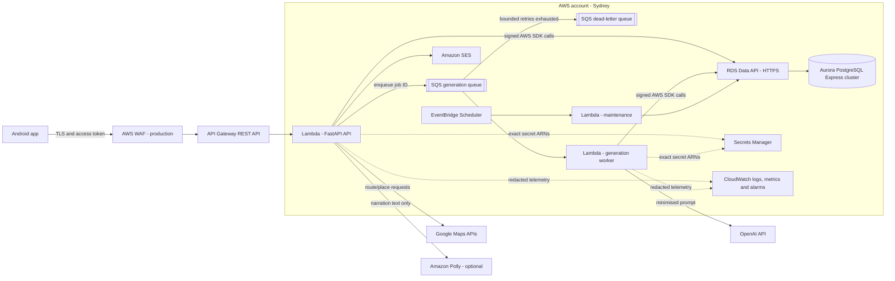

# AWS server refactoring proposal

Status: Core FastAPI endpoints and native authentication ported locally; development redeployment and end-to-end verification pending

Last reviewed: 2026-10-24

Target region: `ap-southeast-2` (Sydney)  
Primary goal: safely support at least 100 concurrently active users with a small operational and cost footprint.

## Recommendation

Deploy the FastAPI application as a modular monolith on AWS Lambda behind API
Gateway. Keep PostgreSQL because study membership, consent, questionnaires,
responses, and refresh-token rotation need relational constraints and
transactions.

For the current single AWS account, use a deliberately pared-back serverless
baseline:

- API Gateway REST API using its generated AWS hostname;
- one API Lambda, with no VPC attachment and no provisioned concurrency;
- one Aurora PostgreSQL Serverless v2 cluster created with Express
  Configuration for Free Plan development verification;
- RDS Data API over HTTPS rather than direct database connections;
- SQS, a worker Lambda, and a DLQ for slow or burst-sensitive generation;
- SES for transactional email;
- Secrets Manager for a separate Data API application credential and
  third-party API keys; and
- CloudWatch with short log retention, essential alarms, and redacted logs; and
- AWS WAF managed and authentication-route rate rules on production only.

This removes the baseline NAT Gateway, RDS Proxy, Lambda VPC networking, custom
domain, Route 53 hosted zone, and customer-managed KMS keys. Free Plan Aurora
must be created with Express Configuration, which supplies AWS-managed
connectivity through an internet access gateway rather than a customer VPC.
The application Lambdas use the Data API over signed HTTPS. WAF is a mandatory
production-launch gate, but is omitted from development to avoid unnecessary
cost.

TTS uses a provider-neutral HTTP boundary with a current
`TTS_PROVIDER=polly|disabled` implementation. The initial provider is
synchronous Amazon Polly using the standard Australian English `Russell` and
`Nicole` voices and MP3 output. Only narration text is disclosed to Polly.
Audio is cached in Android app-private storage; no server-side audio bucket is
provisioned. Disabling TTS leaves script generation and text-only playback
available and preserves the boundary for later provider evaluation. The
server-side selector is not yet a general provider registry; the swap procedure
is documented in [`tts-implementation-and-testing.md`](tts-implementation-and-testing.md).

The AWS Free Plan is an allowance/credit mechanism, not a guarantee that this
stack has a zero bill. The goal is to validate the complete synthetic
development deployment within its Aurora Express limits: no more than 4 ACUs
and 1 GiB storage for the project cluster. Secrets Manager, logs, email, Data
API requests, and usage beyond allowances can consume credits or incur charges.
Budgets and alerts are mandatory. The client must upgrade to a paid plan before
the Free Plan expires and before the long-lived production rollout.

## Overall service schematic



The Lambda functions are not attached to a VPC. The Data API provides a signed
HTTPS interface and manages database connections. That is the key
simplification: calls to Google and OpenAI can use Lambda's normal internet
path, so there is no NAT Gateway hourly or processing charge. The Express
cluster is provisioned once outside CDK because CloudFormation does not expose
the required Express create option; CDK manages the separate `wm_app` secret
and all surrounding workload resources.

## Account and environment model

The project will use one AWS account. During Free Plan validation, keep only one
deployed `dev` stack and use synthetic data. At handover, deploy a clean
`production` stack from the reviewed release and transfer operational ownership.
After the paid-plan upgrade, the client may retain a separate `dev` stack for
feature validation. It must use its own Aurora cluster, secrets, queues,
functions, API, and log groups and must continue to contain synthetic data only.

API Gateway's CloudWatch logging role is an account-and-Region setting rather
than an environment resource. Configure that role once in `ap-southeast-2` and
let both REST APIs use it; the environment API stacks must not create competing
`AWS::ApiGateway::Account` resources.

Logical stack names, roles, secrets, and tags include the environment name, but
this is resource organization rather than a security or quota boundary. Never
copy production data into development. If the client later requires stronger
isolation, separate AWS accounts are the preferred future boundary.

## Request flows

### Normal API call

1. The Android app calls the generated API Gateway HTTPS URL.
2. FastAPI validates the short-lived access token and applies authorization.
3. The repository issues parameterised SQL through the RDS Data API.
4. The response sets `Cache-Control: no-store` for sensitive endpoints and
   contains no infrastructure credentials.

API Gateway throttling and application-level pseudonymous per-IP/per-account
login limits provide the initial abuse controls. Production additionally uses
WAF managed rules and a narrow authentication-route rate rule before public
launch.

### Refresh and password reset

Keep the strengthened custom session design:

- 15-minute access JWTs;
- opaque, hashed refresh tokens;
- rotation on every refresh;
- a unique parent link and family-wide revocation on replay;
- `SELECT ... FOR UPDATE` within a Data API transaction for refresh, password
  reset, and token-family changes;
- `session_version` invalidation after password reset and each successful login,
  with existing refresh tokens revoked so only the newest device remains signed
  in; and
- Android Keystore encryption with session storage excluded from backup and
  device transfer.

Application MFA is deliberately out of scope for this release. Compensating
controls are mandatory: Argon2id passwords, equal-cost unknown-user checks,
progressive account/IP login throttling, generic login failures, verified email
before sensitive use, shorter admin access sessions, JWT issuer/audience/`kid`
validation with current/previous key rotation, password rehash-on-login,
security-event auditing, all-device logout, and immediate account disablement.
Human AWS administrators still require MFA; that is separate from application
MFA.

Data API transactions use `BeginTransaction`, pass the returned transaction ID
to each statement, and finish with `CommitTransaction` or `RollbackTransaction`.
Add a JWT `kid` and support current and previous signing keys during rotation.
Prune expired token rows with the scheduled maintenance function. The same
maintenance Lambda removes accounts that remain unverified for seven days,
after their 24-hour verification links have expired and can still be resent.

Do not move authentication to Cognito in this phase. It would replace rather
than simplify the current session work and would not remove application-level
researcher, study, and privacy authorization.

### Route generation

Keep route generation synchronous initially, with an end-to-end timeout below
the API Gateway integration timeout. If measured p95 latency approaches the
limit, move it to the existing job API.

Treat coordinates as transient request data:

- never log request bodies, coordinates, polylines, or authorization headers;
- do not persist route history beyond the bounded seven-day generation result
  needed for asynchronous mobile retrieval;
- send Google only the coordinates necessary for the selected operation; and
- remove exact coordinates and account identity from OpenAI prompts.

### Script and optional audio generation

The asynchronous job contract below is implemented locally but has not yet
been deployed over the synthetic development baseline. The migrated application
also retains the legacy synchronous
`/route/generate-script/park` and `/route/generate-script/without-park` paths
with a deterministic fallback generator, plus a separate authenticated
`POST /tts` endpoint. The asynchronous worker currently uses that same fallback;
the OpenAI/elevation/nearby-context processor remains to be implemented.

Asynchronous contract:

```text
POST /v1/generation-jobs      -> 202 { job_id, status_url }
GET  /v1/generation-jobs/{id} -> queued | running | complete | failed
GET  /v1/generation-jobs/{id}/result -> generated script result
```

The API writes an idempotent job and outbox row in one transaction, then sends
only the job ID to SQS. Scheduled maintenance retries undelivered outbox rows.
The worker claims the job, generates and validates the script, and stores the
script result in PostgreSQL. Use a client-generated idempotency key so mobile
retries do not duplicate paid work.

The domain model separates `script_status` from `audio_status`. With
`TTS_PROVIDER=disabled`, a script job completes with `audio_status=disabled`.
For the initial Polly integration, the authenticated client requests MP3 for
bounded narration chunks and caches the result locally. The provider adapter
can be replaced without changing the script contract. Object storage and
signed URLs remain deferred unless measurements show synchronous delivery is
inadequate.

Configure the SQS source with batch size 1 and low maximum concurrency. The
current development account uses 2 because its regional Lambda concurrency
quota is 10; raise it only after quota and load-test evidence support doing so.
Apply per-user in-flight and daily limits. Failed jobs use bounded retries with
jitter and then move to a DLQ with an alarm.

## Service choices

| Concern | Initial choice | Reason |
| --- | --- | --- |
| Public API | API Gateway REST API, AWS hostname; WAF in production | Lambda proxy integration, throttling, and a production-launch edge control without development WAF cost. |
| Web framework | FastAPI on one API Lambda | Preserves validation and endpoint work without premature microservices. |
| Long work | SQS, worker Lambda, DLQ | Back-pressure, retry, and failure isolation. |
| Primary data | Aurora PostgreSQL Serverless v2 Express Configuration | Free Plan-eligible validation plus relational integrity, JSONB, transactions, and row locking. |
| Database transport | RDS Data API | No driver pool, RDS Proxy, Lambda VPC attachment, or NAT Gateway. |
| Speech | Optional Amazon Polly (`Russell`/`Nicole`, standard, `en-AU`) | Managed synthesis without model/FFmpeg dependencies; provider can be disabled or replaced. |
| Email | SES | Transactional email with IAM-based access. |
| Secrets | Secrets Manager | Required for the Data API credential and appropriate for external keys. |
| Observability | CloudWatch | Essential metrics, alarms, and short-retention redacted logs. |
| Infrastructure | AWS CDK in Python | Reviewable, repeatable infrastructure beside the server. |

## Refactoring shape

```text
meditation-server/
  src/meditation_server/
    api/
      app.py                 # FastAPI construction
      handler.py             # API Gateway/Lambda adapter
      routes/                # thin HTTP boundary
      dependencies.py
    auth/                    # password, JWT, refresh-token policy
    domain/                  # study/questionnaire/consent rules
    application/             # use cases and transaction boundaries
    repositories/
      interfaces.py
      sql/                   # shared parameterised PostgreSQL statements
      data_api.py            # AWS transport
      asyncpg.py             # local/integration-test transport
    integrations/
      google/
      openai/
      speech.py              # SpeechSynthesizer protocol + disabled adapter
      ses.py
    workers/
      generation.py
      maintenance.py
    observability.py
    settings.py
  migrations/                # ordered SQL, runnable through either transport
  infra/                     # AWS CDK stacks
  tests/
    unit/
    integration/
    load/
  docs/
```

Use the same parameterised SQL and transaction semantics behind two executors:
`asyncpg` for disposable local PostgreSQL and RDS Data API in AWS. This avoids
maintaining two query implementations while keeping local tests practical.
Migrations are ordered SQL files applied explicitly by a deployment command or
non-public function; never run them during Lambda cold start.

Additional rules:

- Keep route handlers thin and test authorization in application services.
- Inject Google, OpenAI, speech, email, clock, and repositories.
- Exclude Qwen, Torch, torchaudio, FFmpeg, model files, and scientific packages
  from the API and worker artifacts.
- Create AWS clients outside handlers for warm reuse, without retaining user
  data in global state.
- Grant API, worker, and maintenance functions separate least-privilege roles.
- Never log tokens, email, answers, feedback, prompts, coordinates, polylines,
  or generated scripts.
- Make job transitions conditional and idempotent because SQS is at-least-once.
- Paginate exports and large query results; a Data API response is limited to
  1 MiB.

## Concurrency and capacity plan

“100 concurrent users” does not mean 100 requests per second. Define acceptance
as 100 authenticated virtual users performing a realistic mix of reads, writes,
refreshes, route requests, and generation submissions for at least 15 minutes.

Initial guardrails:

- API Lambda reserved concurrency: omit it while the account quota remains 10;
  no positive reservation is possible because Lambda must retain 100 unreserved
  units. The quota-increase request was rejected, so the 100-user acceptance
  test remains explicitly unverified before handover. After a future increase,
  the client should choose a ceiling from measured peak concurrency and
  downstream capacity rather than adopting 150 automatically.
- API memory: start at 1,024 MB and tune from measurements.
- API timeout: 25 seconds, below the gateway integration timeout.
- Worker SQS maximum concurrency: 2 with batch size 1 during Free Plan
  deployment testing; increase only after observing queue age and downstream
  health.
- Aurora: remain within the Express Free Plan limits of 4 ACUs and 1 GiB for
  development verification. After the client upgrades, measure capacity and
  decide whether to retain Express or migrate to full configuration for
  production networking, capacity, and HA controls.
- No provisioned Lambda concurrency initially.
- Explicit API Gateway, per-account, and per-user limits protect Aurora and paid
  downstream services.

Acceptance criteria include less than 1% unexpected HTTP errors, no auth or
authorization failures caused by load, no sustained Lambda throttling, no Data
API/database exhaustion, job submission p95 below one second, and successful
SQS retry/DLQ recovery. Set the final synchronous p95 target with the client;
start with one second excluding third-party route calls.

## Security and privacy work

The combined dataset includes identifiers, demographics, study participation,
consent, questionnaire answers that may contain health information, free text,
and precise location. Treat it as sensitive.

Highest-priority changes:

1. **Minimise third-party disclosure.** Remove coordinates and identifiers from
   AI prompts, restrict free text, document Google/OpenAI recipients and
   processing locations, and obtain privacy/ethics review before production.
2. **Version consent.** Store an immutable consent-form version and content hash
   with each acceptance, including third parties, retention, and withdrawal.
3. **Pseudonymise researcher views.** Use a random participant code per study;
   separate identity mapping and restrict it more tightly.
4. **Implement retention.** Automate cleanup for tokens, reset records, job
   payloads, logs, backups, withdrawn participants, and responses.
5. **Audit sensitive application actions.** Record actor, action, study,
   timestamp, and outcome for exports, rosters, responses, consent, researcher
   verification, and role changes—never the sensitive contents.
6. **Resolve study policy server-side.** Do not trust client-supplied study
   instructions or experiment-arm parameters.
7. **Constrain unstructured input.** Apply request/body/field limits, approved
   questionnaire schemas, encoding, and prompt validation.

Also enforce email verification, researcher approval and study ownership,
generic password-reset responses, server-side generation quotas, UUID parsing
for join links, and controlled first-admin seeding. Use AWS-managed encryption
for Aurora, SQS, and logs initially. Add customer-managed KMS keys only when the
client has an explicit key-ownership/rotation need and accepts the cost.

Production data must not enter developer laptops or the development stack.
Use Aurora Express's one-day backup retention for Free Plan development and
synthetic production verification; the Free Plan rejects longer automated
retention. Keep deletion protection enabled for the rehearsal. After moving to
the paid plan, increase long-lived production to 30-day PITR. Take manual
snapshots before destructive migrations and handover, retain them according to
the backup policy, and perform a documented monthly restore test. Aurora
already captures incremental changes continuously, so a separate weekly-full,
daily-differential, hourly-log schedule would duplicate the service's native
model. See [`backup-policy.md`](backup-policy.md).

This is engineering guidance, not legal advice. The client/university privacy
officer and research ethics process should confirm Privacy Act/APP applicability,
cross-border disclosure, consent wording, and research-record retention.

## Delivery sequence

### Phase 0 - decisions and threat model

- Confirm the single account owner, Sydney region, synthetic development
  environment, production environment, recovery objectives, and billing
  handover.
- Inventory data sent to Google and OpenAI and define retention and consent.
- Record Polly as the initial optional provider and preserve `disabled` mode.

### Phase 1 - application extraction

- Implemented locally: package boundaries, Mangum Lambda handler, split
  dependency locks, shared SQL, asyncpg/Data API executors, explicit Data API
  transactions, and ordered checksummed migrations.
- Implemented locally: native authentication, study, questionnaire,
  questionnaire-response, feedback, route, script-contract, and TTS endpoints.
- Remaining verification: run the migrated application against Aurora and
  complete refresh-token race/replay coverage through both executors.

### Phase 2 - minimal AWS foundation and Free Plan verification

- Provision one Aurora Express cluster, enable Data API, create the separate
  application credential, then deploy API Gateway, Lambda, Secrets Manager,
  SES, SQS/DLQ, worker, CloudWatch, budgets, and OIDC roles.
- Deploy synthetic data only and apply migrations explicitly.
- Verify the complete development deployment within the Free Plan limits and
  record the client-owned paid-plan transition deadline.

### Phase 3 - asynchronous generation and optional TTS

- Implemented locally: the optional Polly call path and authenticated MP3
  endpoint. Qwen, Torch, FFmpeg, model files, and server-side audio storage are
  excluded from Lambda.
- Pending app pull-request review: Android app-private MP3 caching and text-only
  failure behavior. Inventory all `/tts` callers before accepting the client
  integration because the legacy script screen still sends obsolete
  Qwen-specific request fields.
- Remaining: live Polly/device and disabled-mode testing.
- Implemented locally: job/outbox tables, polling endpoints, idempotent
  submission, scheduled outbox recovery/retention, conditional worker job
  transitions, and the OpenAI/elevation/weather/nearby-context script generator
  with a deterministic safety fallback.
- Remaining: live provider and DLQ recovery exercises.

### Phase 4 - privacy and readiness

- Implement consent versioning, study participant codes, audit events, email
  verification, retention, and privacy notices.
- Run authorization, restore, DLQ, secret, and dependency tests. Record the
  100-user test as deferred until the client obtains a sufficient concurrency
  quota after handover.

## Deferred items

- Route 53, ACM, and a custom API domain;
- RDS Proxy, NAT Gateway, and Lambda VPC attachment;
- customer-managed KMS keys;
- provisioned concurrency;
- server-side audio storage, signed audio URLs, and alternate TTS providers; and
- multi-account or multi-region deployment.

## Reference constraints

- [RDS Data API](https://docs.aws.amazon.com/AmazonRDS/latest/AuroraUserGuide/data-api.html)
- [Data API regional and engine support](https://docs.aws.amazon.com/AmazonRDS/latest/AuroraUserGuide/Concepts.Aurora_Fea_Regions_DB-eng.Feature.Data_API.html)
- [Data API limitations](https://docs.aws.amazon.com/AmazonRDS/latest/AuroraUserGuide/data-api.limitations.html)
- [Aurora Serverless v2 auto-pause](https://docs.aws.amazon.com/AmazonRDS/latest/AuroraUserGuide/aurora-serverless-v2-auto-pause.html)
- [Lambda concurrency](https://docs.aws.amazon.com/lambda/latest/dg/lambda-concurrency.html)
- [SQS event-source maximum concurrency](https://docs.aws.amazon.com/lambda/latest/dg/services-sqs-scaling.html)
- [CloudWatch Logs sensitive-data masking](https://docs.aws.amazon.com/AmazonCloudWatch/latest/logs/mask-sensitive-log-data.html)
- [OAIC Australian Privacy Principles](https://www.oaic.gov.au/privacy/australian-privacy-principles/read-the-australian-privacy-principles)
- [OAIC APP 8 guidance](https://www.oaic.gov.au/privacy/australian-privacy-principles/australian-privacy-principles-guidelines/chapter-8-app-8-cross-border-disclosure-of-personal-information)
