# Aurora PostgreSQL database schema

This document is the relational view of the `walking_meditation` database used
by the Aurora PostgreSQL cluster. The AWS RDS console shows the Aurora cluster
topology, configuration, status, and metrics. Its Query Editor can run SQL
through the Data API, but it does not generate an entity-relationship diagram
for the application schema.

The numbered SQL files in [`../migrations`](../migrations) remain the source of
truth. Update this diagram whenever a migration adds, removes, or changes a
table or foreign key. `wm_schema_migrations` is created by the migration runner
rather than by a numbered migration.

`users.age` is optional for legacy/uncompleted profiles; when present it is
constrained to 18–120. Deleting a user sets
`questionnaire_responses.respondent_id` to `NULL`, preserving submitted answers
without retaining the deleted account reference.

## Entity-relationship diagram

```mermaid
erDiagram
    USERS {
        uuid id PK
        text email UK
        text password_hash
        integer session_version
        text gender
        integer age
        user_role role
        boolean email_verified
        text pending_researcher_institution
        timestamptz disabled_at
        timestamptz created_on
    }

    RESEARCHER_PROFILES {
        uuid user_id PK, FK
        text institution
        timestamptz verified_at
        timestamptz created_on
    }

    PASSWORD_RESET_TOKENS {
        uuid id PK
        uuid user_id FK
        text token_hash UK
        timestamptz expires_at
        timestamptz used_at
        timestamptz created_on
    }

    EMAIL_VERIFICATION_TOKENS {
        uuid id PK
        uuid user_id FK
        text token_hash UK
        timestamptz expires_at
        timestamptz used_at
        timestamptz created_on
    }

    REFRESH_TOKENS {
        uuid id PK
        uuid user_id FK
        uuid family_id
        uuid parent_id FK, UK
        text token_hash UK
        timestamptz expires_at
        timestamptz revoked_at
        timestamptz created_on
    }

    LOGIN_THROTTLES {
        text subject_hash PK
        integer failed_attempts
        timestamptz blocked_until
        timestamptz updated_on
    }

    SECURITY_EVENTS {
        uuid id PK
        uuid user_id FK
        text event_type
        text subject_hash
        timestamptz occurred_at
    }

    STUDY {
        uuid id PK
        text name
        integer duration
        text description
        text control_script_generation_parameters
        text experimental_script_generation_parameters
        study_status status
        timestamptz activated_at
    }

    STUDY_CREATED_BY {
        uuid researcher_id FK
        uuid study_id PK, FK
        timestamptz created_on
    }

    CONSENT_FORM {
        uuid study_id PK, FK
        text body_text
        integer version
    }

    STUDY_REGISTRATIONS {
        uuid user_id PK, FK
        uuid study_id PK, FK
        text respondent_code UK
        timestamptz registered_at
        timestamptz consented_at
        timestamptz withdrawn_at
        study_group study_group
    }

    FEEDBACK {
        uuid id PK
        uuid user_id FK
        uuid study_id FK
        feedback_category category
        integer rating
        text comment
        timestamptz created_at
    }

    QUESTIONNAIRES {
        uuid id PK
        text title
        uuid researcher_id FK
        questionnaire_status status
        jsonb definition
        timestamptz created_on
    }

    STUDY_QUESTIONNAIRES {
        uuid id PK
        uuid study_id FK
        uuid questionnaire_id FK
        integer round_number
        timestamptz issued_at
        timestamptz revoked_at
    }

    QUESTIONNAIRE_RESPONSES {
        uuid id PK
        uuid study_questionnaire_id FK
        uuid respondent_id FK
        text respondent_code
        jsonb answers
        timestamptz submitted_on
    }

    RESPONSE_EXPORTS {
        uuid id PK
        uuid researcher_id FK
        response_export_scope scope
        uuid study_id FK
        response_export_status status
        bigint source_response_count
        timestamptz source_last_submitted_on
        integer attempt_count
        text lease_token
        timestamptz lease_expires_at
        text s3_key
        text filename
        timestamptz generated_at
        timestamptz expires_at
        timestamptz notification_sent_at
    }

    RESPONSE_EXPORT_OUTBOX {
        uuid id PK
        uuid export_id FK, UK
        integer attempt_count
        timestamptz next_attempt_at
        timestamptz published_at
        text last_error_code
        timestamptz created_at
    }

    GENERATION_JOBS {
        uuid id PK
        uuid user_id FK
        text idempotency_key
        text request_hash
        generation_job_kind kind
        jsonb request_payload
        generation_job_status status
        generation_audio_status audio_status
        integer attempt_count
        text lease_token
        timestamptz lease_expires_at
        jsonb result
        text last_error_code
        timestamptz created_at
        timestamptz updated_at
        timestamptz completed_at
    }

    GENERATION_OUTBOX {
        uuid id PK
        uuid job_id FK, UK
        text event_type
        integer attempt_count
        timestamptz next_attempt_at
        timestamptz published_at
        text last_error_code
        timestamptz created_at
    }

    WM_SCHEMA_MIGRATIONS {
        text version PK
        text name UK
        text checksum
        timestamptz applied_at
    }

    USERS ||--o| RESEARCHER_PROFILES : has
    USERS ||--o{ PASSWORD_RESET_TOKENS : receives
    USERS ||--o{ EMAIL_VERIFICATION_TOKENS : receives
    USERS ||--o{ REFRESH_TOKENS : owns
    REFRESH_TOKENS o|--o| REFRESH_TOKENS : rotates_to
    USERS o|--o{ SECURITY_EVENTS : associated_with

    USERS ||--o{ STUDY_CREATED_BY : creates
    STUDY ||--o| STUDY_CREATED_BY : records_creator
    STUDY ||--o| CONSENT_FORM : has
    USERS ||--o{ STUDY_REGISTRATIONS : registers
    STUDY ||--o{ STUDY_REGISTRATIONS : enrols
    USERS ||--o{ FEEDBACK : submits
    STUDY o|--o{ FEEDBACK : receives

    USERS o|--o{ QUESTIONNAIRES : authors
    STUDY ||--o{ STUDY_QUESTIONNAIRES : issues
    QUESTIONNAIRES ||--o{ STUDY_QUESTIONNAIRES : scheduled_as
    STUDY_QUESTIONNAIRES ||--o{ QUESTIONNAIRE_RESPONSES : collects
    USERS o|--o{ QUESTIONNAIRE_RESPONSES : submits

    USERS ||--o{ RESPONSE_EXPORTS : requests
    STUDY o|--o{ RESPONSE_EXPORTS : limits_scope_to
    RESPONSE_EXPORTS ||--o| RESPONSE_EXPORT_OUTBOX : publishes_via

    USERS ||--o{ GENERATION_JOBS : requests
    GENERATION_JOBS ||--o| GENERATION_OUTBOX : publishes_via
```

## Scope and constraints

- Nullable foreign keys are shown as optional relationships. Deleting a linked
  user sets the user reference to `NULL` for security events, questionnaires,
  and questionnaire responses. `feedback.study_id` is also nullable, but a
  linked feedback row is deleted when its study is deleted.
- `study_registrations` has a composite primary key of `(user_id, study_id)`.
- The diagram includes columns and relationships, while the migrations also
  define check constraints, partial indexes, defaults, enum values, and compound
  uniqueness rules. Consult the migration SQL before changing application logic.
- `login_throttles` and `wm_schema_migrations` are intentionally standalone.

## AWS console views

- **RDS > Databases > cluster** shows the Aurora resource topology and cluster
  details; it is useful for operational inspection, not relational modelling.
- **Actions > Query** opens the Aurora Query Editor because this cluster has the
  RDS Data API enabled. Use it for SQL inspection, not as the canonical schema
  diagram.

AWS references: [viewing Aurora cluster status](https://docs.aws.amazon.com/AmazonRDS/latest/AuroraUserGuide/accessing-monitoring.html)
and [using the Aurora Query Editor](https://docs.aws.amazon.com/AmazonRDS/latest/AuroraUserGuide/query-editor.html).
