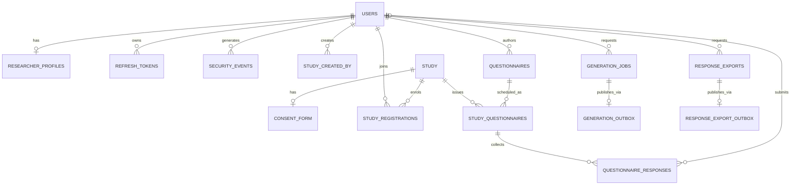

# Walking Meditation server operation guide

Last reviewed against this repository: 12 November 2026

This is the primary deployment and operations runbook for `meditation-server`.
It is intended to be adapted into client instructions, but the procedures here
are deliberately complete enough for a technically capable operator to follow
directly. Commands use PowerShell and AWS CLI v2 unless stated otherwise.

The complete documentation set is intentionally limited to four files:

- this operations handbook;
- `api-reference.md`, the authoritative HTTP contract;
- `aws-deployment-guide.md`, the fresh-account and deployment procedure; and
- `testing-guide.md`, the authoritative test commands and acceptance flows.

The deployment and endpoint sections retained here are operational checklists.
When exact request fields or deployment inputs are needed, use the dedicated
file above and update both documents if an operational dependency changes.

This guide distinguishes three kinds of statement:

- **Implemented** means the behavior exists in the current source or CDK.
- **Operator decision** means a named owner must choose or approve a value.
- **Launch gap** means the workflow does not yet exist or is not adequate for a
  public production launch. A checklist item must not be marked complete merely
  because it is documented here.

The system is restricted to `ap-southeast-2`. Replace values in angle brackets
before running a command. Never paste passwords, API keys, JWT keys, database
tokens, access/refresh/reset/verification tokens, questionnaire answers, route
coordinates, or production data into command history, tickets, or chat.

## 1. Current operational truth

The synthetic `dev` infrastructure verified on 24 October 2026 was created in a
project testing AWS account that will become defunct. It is not the client's
deployment target, migration source, recovery source, or operational baseline.
Production has not been deployed.

The client must build from a reviewed repository commit into a new client-owned
AWS account. Recreate the CDK bootstrap, GitHub OIDC roles, Aurora cluster,
database schema, secrets, provider keys, SES identity, stacks, URLs, alarms and
verification evidence there. Do not reuse or migrate account IDs, ARNs, roles,
credentials, secrets, snapshots, application data, buckets, outputs, logs or
URLs from the testing account. Decommissioning that account is separate work for
its owner.

Live Aurora endpoint tests, live Polly/device playback, restore testing,
workflow failure exercises, WAF rehearsal, and capacity testing must therefore
be performed again in the client account; historical test-account evidence does
not satisfy the client's release gates.

Do not infer live state from this document. Verify it using Section 6 every time.
Do not process real participant data until the public-launch checklist in
Section 15 has been approved by the client and the appropriate university
privacy/ethics owners.

The target architecture created from this repository is:

- API Gateway REST API -> Python 3.14 FastAPI Lambda;
- external Aurora PostgreSQL Serverless cluster created with Express
  Configuration, accessed by Lambda through the RDS Data API;
- Secrets Manager for the application database credential, JWT signing key,
  authentication rate-limit pepper, Google key, and OpenAI key;
- SQS + Lambda for generation jobs and response exports, with separate DLQs;
- EventBridge Scheduler maintenance for outbox recovery and cleanup;
- S3 for seven-day response exports and a development-only seven-day generation
  archive;
- SES for verification, password-reset, and export-ready email;
- optional Polly for MP3 synthesis;
- CloudWatch Logs, metrics and alarms, SNS operational alerts, AWS Budgets,
  CloudTrail, and a production-only WAF.

`dev` and `prod` are separate stacks and secrets, but in the current design they
may share one AWS account. That is operational separation, not a security or
quota boundary. Development is synthetic-data-only and must never receive a
copy of production data.

## 2. Roles and ownership

AWS identities and application administrators are different systems:

- An **AWS operator** manages the account, CloudFormation, Aurora, secrets,
  queues, logs, backups, alarms, and deployments.
- An **application admin** is a row in Aurora with `users.role = 'admin'` and
  uses admin API endpoints. Application admins receive no AWS access.

Record the client account owner and named primary and backup contacts for billing, security,
production approval, database recovery, SES reputation, privacy requests,
research-data retention, and DLQ incidents. Use maintained client mailboxes for
alerts, not one student's address.

Recommended human access roles are:

| Role | Intended permissions |
| --- | --- |
| Read-only operator | CloudFormation/RDS/Lambda/API Gateway/SQS/S3 metadata, CloudWatch/CloudTrail reads, no secret values and no mutations |
| Incident operator | Read-only plus queue redrive, alarm acknowledgement, and tightly scoped operational actions under change control |
| Database migration operator | RDS Data API access only to the named cluster/database and application secret; migration execution, not arbitrary IAM administration |
| Deployment approver | Approves the protected GitHub production environment; does not need persistent AWS credentials |
| Platform administrator | CDK bootstrap, permissions-boundary, OIDC, and controlled infrastructure changes |
| Billing/security administrator | Billing, contacts, GuardDuty/Security Hub/Inspector posture and incident-response access as approved |
| Break-glass administrator | Time-limited emergency role, MFA required, monitored on every use, credentials stored by the client |

## 3. AWS account and IAM setup

### 3.1 Root and human access

1. Set root, alternate security, operations, and billing contacts to durable
   client-controlled details.
2. Register two independent root MFA methods. Never create root access keys and
   never use root for routine deployment.
3. Prefer federation and temporary sessions. Do not create shared IAM users or
   distribute long-lived AWS access keys to developers.
4. If the account remains on the AWS Free Plan, first confirm the effect of
   enabling AWS Organizations or an organization instance of IAM Identity
   Center. The repository's current plan deliberately avoids Organizations
   during that phase. After the paid-plan transition, use IAM Identity Center
   groups and least-privilege permission sets where appropriate. AWS recommends
   group assignment and choosing the most restrictive usable permission set:
   <https://docs.aws.amazon.com/singlesignon/latest/userguide/assignusers.html>
   and <https://docs.aws.amazon.com/singlesignon/latest/userguide/permissionsets.html>.
5. Require MFA for all human administrators. Create named identities; never
   share a console login.
6. Keep a quarterly access review: identities, role trust, permission sets,
   active access keys, credential report, Access Analyzer findings, GitHub OIDC
   subject, and break-glass use.

For an operator session:

```powershell
aws login --profile wm-admin --region ap-southeast-2
$identity = aws sts get-caller-identity --profile wm-admin --region ap-southeast-2 | ConvertFrom-Json
$identity
$expectedAccount = '<CLIENT_AWS_ACCOUNT_ID>'
if ($identity.Account -ne $expectedAccount) { throw 'Wrong AWS account.' }
if ($identity.Arn -match ':root$') { throw 'Do not operate as root.' }
```

Stop if the account ID or principal is not the intended client identity; never
operate against the former testing account. End the session when finished:

```powershell
aws logout --profile wm-admin
```

### 3.2 Least privilege and role rules

- Keep trust policies separate from permissions policies.
- Scope `iam:PassRole` to named roles and the intended AWS service. Never pair
  unrestricted `iam:PassRole` with Lambda/CloudFormation creation permissions.
- Workload roles are created by CDK and receive the `WM-CdkBoundary` permissions
  boundary. Do not attach `AdministratorAccess` to a Lambda role.
- Scope Data API statements to the exact Aurora cluster ARN and secret reads to
  the exact secret ARN. S3 permissions are prefix-specific.
- Restrict GitHub OIDC trust to the exact repository, environment and audience.
  The current roles trust `environment:dev` or `environment:production`, not an
  arbitrary repository or branch.
- Use separate roles for API, generation worker, export worker, maintenance,
  scheduler and deployment. Do not reuse one general service role.
- Review CloudTrail after any IAM or trust-policy change.

The CDK policies are the canonical runtime policies. As a review control, use
IAM Policy Autopilot against actual Python AWS SDK calls, compare its output to
the synthesized roles, and do not upload its output automatically. `uvx` is not
currently installed in the development environment used to review this guide.
Install `uv` first, then run:

```powershell
python -m pip install uv
$account = aws sts get-caller-identity --profile wm-admin --query Account --output text
$repo = (Resolve-Path .).Path
$runtimeFiles = @(
  (Resolve-Path "$repo/src/meditation_server/settings.py").Path,
  (Resolve-Path "$repo/src/meditation_server/repositories/data_api.py").Path,
  (Resolve-Path "$repo/src/meditation_server/application/outbox.py").Path,
  (Resolve-Path "$repo/src/meditation_server/application/response_exports.py").Path,
  (Resolve-Path "$repo/src/meditation_server/integrations/email.py").Path,
  (Resolve-Path "$repo/src/meditation_server/integrations/response_export_storage.py").Path,
  (Resolve-Path "$repo/src/meditation_server/integrations/script_archive.py").Path,
  (Resolve-Path "$repo/src/meditation_server/integrations/speech.py").Path
)
uvx iam-policy-autopilot@latest generate-policies @runtimeFiles `
  --region ap-southeast-2 `
  --account $account `
  --service-hints secretsmanager rds-data sqs s3 ses polly `
  --pretty
```

Review with IAM Access Analyzer and the IAM Policy Simulator. Do not use
`--upload-policies` without a reviewed change request and explicit approval.

### 3.3 CDK boundary, bootstrap and GitHub OIDC

Create or update the boundary from the repository:

```powershell
$account = aws sts get-caller-identity --profile wm-admin --query Account --output text
$boundaryArn = "arn:aws:iam::${account}:policy/WM-CdkBoundary"
aws iam get-policy --policy-arn $boundaryArn --profile wm-admin 2>$null
if ($LASTEXITCODE -eq 0) {
  aws iam create-policy-version --policy-arn $boundaryArn `
    --policy-document file://bootstrap/WM-CdkBoundary.json `
    --set-as-default --profile wm-admin
} else {
  aws iam create-policy --policy-name WM-CdkBoundary `
    --policy-document file://bootstrap/WM-CdkBoundary.json `
    --profile wm-admin
}
```

An IAM managed policy can have only five versions. If the update reaches the
limit, list versions and delete an old non-default version after review.

Bootstrap once:

```powershell
npm ci
npx cdk bootstrap "aws://${account}/ap-southeast-2" `
  --profile wm-admin `
  --termination-protection `
  --custom-permissions-boundary WM-CdkBoundary
```

Deploy the identity stack separately:

```powershell
python -m venv .venv
.\.venv\Scripts\Activate.ps1
python -m pip install -r requirements.txt
npx cdk diff WmIdentity --profile wm-admin
npx cdk deploy WmIdentity --profile wm-admin --require-approval broadening
```

Record `GitHubDeployerDevRoleArn` and `GitHubDeployerProdRoleArn`. If the client
repository owner or name changes, update the OIDC subjects first, verify the new
workflow, and then remove trust for the old repository identity.

### 3.4 Shared API Gateway CloudWatch role (Console action)

API Gateway has one account-level CloudWatch role per account and Region. In the
AWS Console, select **Asia Pacific (Sydney)**, open **API Gateway -> Settings ->
Logging -> Edit**, and set a role that trusts `apigateway.amazonaws.com` and has
the AWS-managed `service-role/AmazonAPIGatewayPushToCloudWatchLogs` policy.

CLI equivalent and verification:

```powershell
$apiGatewayLogsRoleArn = '<API_GATEWAY_LOG_ROLE_ARN>'
aws apigateway update-account `
  --patch-operations "op=replace,path=/cloudwatchRoleArn,value=$apiGatewayLogsRoleArn" `
  --profile wm-admin --region ap-southeast-2
aws apigateway get-account --profile wm-admin --region ap-southeast-2 `
  --query cloudwatchRoleArn --output text
```

Do this once. Environment stacks deliberately do not own this shared setting.

## 4. From-scratch deployment

Follow `aws-deployment-guide.md` from the beginning in the new client account.
The following operational summary works for `dev`. For production, replace `dev` with
`prod`, use the `production` GitHub environment, pass `-AllowProduction` when
provisioning Aurora, set 30-day backup retention after the paid-plan transition,
and complete every production gate in Section 15.

Before any command, verify `aws sts get-caller-identity` returns the new client
account. Never use testing-account ARNs, CDK outputs, secrets or profiles as
placeholders for a client deployment.

### 4.1 Prerequisites and local validation

Required local tools are PowerShell, Git, Python 3.13 (matching deployment CI),
Node 22, AWS CLI v2.33+ for Aurora Express, and an authenticated non-root AWS
profile. CDK packages the application with the Python 3.14 Lambda runtime.

```powershell
git status --short
python -m venv .venv
.\.venv\Scripts\Activate.ps1
python -m pip install -r requirements.txt
npm ci
python -m pytest -q
python -m pytest infra/tests -q
```

Use a reviewed commit from protected `main`. Do not deploy a dirty worktree or
unreviewed local artifact to production.

### 4.2 Create external provider secrets

Create one Secrets Manager secret for the restricted Google server key and one
for the OpenAI project key in `ap-southeast-2`. Use distinct secrets per
environment. The secret value may be a string or JSON containing `api_key` or
`key`. Record only the ARNs.

```powershell
aws secretsmanager describe-secret --secret-id '<GOOGLE_SECRET_ARN>' `
  --profile wm-admin --region ap-southeast-2
aws secretsmanager describe-secret --secret-id '<OPENAI_SECRET_ARN>' `
  --profile wm-admin --region ap-southeast-2
```

Restrict the Google key to the required server-side APIs and approved use;
restrict the OpenAI key to a dedicated project with budgets/limits. Never put
either value in GitHub variables or CDK context.

### 4.3 Prepare SES

In **SES -> Verified identities** in `ap-southeast-2`, verify the sending domain
preferred for production, configure DKIM and the client's SPF/DMARC policy, and
select a sender address for `PASSWORD_RESET_FROM_EMAIL`. New SES accounts are
normally sandboxed per Region and may send only to verified recipients until
production access is approved. Confirm with:

```powershell
aws sesv2 get-account --profile wm-admin --region ap-southeast-2
aws sesv2 list-email-identities --profile wm-admin --region ap-southeast-2
```

Request production access before public registration. AWS's current procedure
is <https://docs.aws.amazon.com/ses/latest/dg/request-production-access.html>.
Configure bounce/complaint monitoring and a maintained operations recipient.

### 4.4 Provision Aurora Express

Aurora is an external prerequisite because CDK/CloudFormation does not expose
the Express creation option used by this project.

```powershell
.\scripts\provision-aurora-express.ps1 -Stage dev -Profile wm-admin
```

For a paid-plan production deployment:

```powershell
.\scripts\provision-aurora-express.ps1 `
  -Stage prod -Profile wm-admin -AllowProduction -BackupRetentionDays 30
```

The script creates or reuses `wm-<stage>-aurora-postgres`, refuses root, enables
the Data API and PostgreSQL log export, enables deletion protection for `prod`
and disables it for `dev`, configures backup retention, creates a
privacy-preserving logging parameter group, and sets CloudWatch database-log
retention to 14 days in dev or 90 days in prod. For an
existing cluster whose logging group must be attached, review the pending reboot
and maintenance window, then run with `-ApplyLoggingParameterGroup`. It does not
apply that association immediately.

Never make the database instance publicly accessible. Express connectivity uses
IAM authentication through its Internet Access Gateway; application traffic
uses the Data API.

### 4.5 Deploy the data stack and initialise `wm_app`

First deploy only `WmData-dev` with placeholder HTTPS URLs that have the required
suffixes. Replace all other placeholders with approved values:

```powershell
npx cdk deploy WmData-dev --profile wm-admin --require-approval broadening `
  -c stage=dev `
  -c databaseClusterArn='<CLUSTER_ARN>' `
  -c workerMaxConcurrency=2 `
  -c monthlyBudgetUsd='<APPROVED_USD>' `
  -c budgetAlertEmail='<BUDGET_MAILBOX>' `
  -c operationalAlertEmail='<OPS_MAILBOX>' `
  -c googleMapsSecretArn='<GOOGLE_SECRET_ARN>' `
  -c openAiSecretArn='<OPENAI_SECRET_ARN>' `
  -c passwordResetFromEmail='<VERIFIED_SES_SENDER>' `
  -c passwordResetLinkBase='https://example.invalid/auth/password-reset/open' `
  -c emailVerificationLinkBase='https://example.invalid/auth/email-verification/open' `
  -c responseExportLinkBase='https://example.invalid/response-exports' `
  -c ttsProvider=disabled
```

Initialise the database role without printing credentials:

```powershell
$cluster = (aws rds describe-db-clusters `
  --db-cluster-identifier wm-dev-aurora-postgres `
  --profile wm-admin --region ap-southeast-2 | ConvertFrom-Json).DBClusters[0]
$outputs = (aws cloudformation describe-stacks --stack-name WmData-dev `
  --profile wm-admin --region ap-southeast-2 | ConvertFrom-Json).Stacks[0].Outputs
$secretArn = $outputs.Where({$_.OutputKey -eq 'DatabaseApplicationSecretArn'}).OutputValue
$secret = aws secretsmanager get-secret-value --secret-id $secretArn `
  --profile wm-admin --region ap-southeast-2 | ConvertFrom-Json
$env:WM_APP_PASSWORD = ($secret.SecretString | ConvertFrom-Json).password
$env:PGPASSWORD = aws rds generate-db-auth-token `
  --hostname $cluster.Endpoint --port $cluster.Port `
  --username $cluster.MasterUsername `
  --profile wm-admin --region ap-southeast-2
python scripts/initialize_aurora_express.py `
  --host $cluster.Endpoint --port $cluster.Port `
  --admin-user $cluster.MasterUsername
Remove-Item Env:WM_APP_PASSWORD, Env:PGPASSWORD
```

Apply ordered, checksummed migrations:

```powershell
$env:DATABASE_RESOURCE_ARN = $cluster.DBClusterArn
$env:DATABASE_SECRET_ARN = $secretArn
$env:DATABASE_NAME = 'walking_meditation'
python scripts/apply_migrations.py --data-api `
  --profile wm-admin --region ap-southeast-2
Remove-Item Env:DATABASE_RESOURCE_ARN, Env:DATABASE_SECRET_ARN, Env:DATABASE_NAME
```

Never edit an applied migration; add the next numbered migration. A checksum
mismatch is a release blocker, not an invitation to update the migration table.

### 4.6 Configure GitHub environments

Create environments named exactly `dev` and `production`; protect `main`, require
a reviewer for production, and disallow administrator bypass where supported.
Set these environment variables separately:

`AWS_ACCOUNT_ID`, `AWS_DEPLOY_ROLE_ARN`, `DATABASE_CLUSTER_ARN`, optional
`API_RESERVED_CONCURRENCY`, `WORKER_MAX_CONCURRENCY`, `MONTHLY_BUDGET_USD`,
`BUDGET_ALERT_EMAIL`, `OPERATIONAL_ALERT_EMAIL`, `GOOGLE_MAPS_SECRET_ARN`,
`OPENAI_SECRET_ARN`, `PASSWORD_RESET_FROM_EMAIL`, `PASSWORD_RESET_LINK_BASE`,
`EMAIL_VERIFICATION_LINK_BASE`, `RESPONSE_EXPORT_LINK_BASE`, `TTS_PROVIDER`,
`WAF_MODE`, and optional `SMOKE_TEST_TTS_VOICE`.

Store `SMOKE_TEST_EMAIL` and `SMOKE_TEST_PASSWORD` as environment secrets. The
smoke account must be synthetic, verified, enabled, dedicated to the workflow,
and not shared with a person. Do not store AWS or provider secret values in
GitHub.

### 4.7 Deploy all stacks and complete the two-pass URL setup

From GitHub Actions, dispatch **Deploy** from `main` and choose `dev` or
`production`. The workflow tests, validates context, synthesizes with cdk-nag,
shows a diff, deploys all six workload stacks, resolves `ApiBaseUrl`, and runs
the smoke suite.

For a manual equivalent, set the same environment variables used by
`.github/workflows/deploy.yml`, then run:

```powershell
python scripts/run_cdk_ci.py validate
python scripts/run_cdk_ci.py synth --strict
python scripts/run_cdk_ci.py diff `
  WmAlerting-dev WmData-dev WmGeneration-dev `
  WmExports-dev WmApi-dev WmOperations-dev
python scripts/run_cdk_ci.py deploy --require-approval never `
  --outputs-file cdk-outputs.json `
  WmAlerting-dev WmData-dev WmGeneration-dev `
  WmExports-dev WmApi-dev WmOperations-dev
```

The first deployment produces the generated API URL. Update the three URL
variables to:

- `<ApiBaseUrl>auth/password-reset/open`
- `<ApiBaseUrl>auth/email-verification/open`
- `<ApiBaseUrl>response-exports`

Redeploy and rerun smoke tests before enabling registration or exports. For
production, start WAF in `count`, exercise all legitimate large payloads, review
redacted WAF logs, change to `block`, review the CDK diff, redeploy, and repeat
the smoke suite.

Confirm both SNS subscription emails: operational alerts and cost alerts. An
unconfirmed subscription receives nothing.

## 5. Post-deployment smoke test

The standard smoke test checks API readiness, database access, login,
authenticated identity, deterministic generation, refresh rotation, optional
Polly MP3, and logout cleanup:

```powershell
$env:SMOKE_BASE_URL = '<HTTPS_API_BASE_URL>'
$env:SMOKE_TEST_EMAIL = '<SYNTHETIC_VERIFIED_ACCOUNT>'
$env:SMOKE_TEST_PASSWORD = '<SET_SECURELY_FOR_THIS_PROCESS>'
# Optional; must match the account's active study voice.
$env:SMOKE_TEST_TTS_VOICE = 'male'
python scripts/post_deployment_smoke.py
Remove-Item Env:SMOKE_BASE_URL, Env:SMOKE_TEST_EMAIL, `
  Env:SMOKE_TEST_PASSWORD, Env:SMOKE_TEST_TTS_VOICE
```

The smoke script never registers or deletes the account. A login replaces its
existing session, so it must not be shared.

## 6. Verify deployed stacks and runtime health

Set `$stage` to `dev` or `prod`:

```powershell
$stage = 'dev'
$region = 'ap-southeast-2'
$profile = 'wm-admin'
$stacks = @(
  "WmAlerting-$stage", "WmData-$stage", "WmGeneration-$stage",
  "WmExports-$stage", "WmApi-$stage", "WmOperations-$stage"
)
foreach ($stack in $stacks) {
  aws cloudformation describe-stacks --stack-name $stack `
    --profile $profile --region $region `
    --query 'Stacks[0].[StackName,StackStatus,EnableTerminationProtection]' `
    --output table
}
```

Accept only stable successful states such as `CREATE_COMPLETE` or
`UPDATE_COMPLETE`. Investigate rollback or in-progress states in CloudFormation
**Events** before retrying. AWS CLI reference:
<https://docs.aws.amazon.com/cli/latest/reference/cloudformation/describe-stacks.html>.

Check drift after an approved maintenance window; drift detection is not a
substitute for a reviewed CDK diff:

```powershell
foreach ($stack in $stacks) {
  aws cloudformation detect-stack-drift --stack-name $stack `
    --profile $profile --region $region
}
```

Verify Aurora:

```powershell
aws rds describe-db-clusters `
  --db-cluster-identifier "wm-$stage-aurora-postgres" `
  --profile $profile --region $region `
  --query 'DBClusters[0].{Status:Status,Engine:Engine,Version:EngineVersion,DataApi:HttpEndpointEnabled,DeletionProtection:DeletionProtection,BackupDays:BackupRetentionPeriod,Logs:EnabledCloudwatchLogsExports,EarliestRestore:EarliestRestorableTime,LatestRestore:LatestRestorableTime}' `
  --output table
```

Expected: `available`, Aurora PostgreSQL, Data API true, `postgresql` log export,
deletion protection false for `dev` and true for `prod`, and one backup day for
Free Plan development/rehearsal or 30 days for paid production. Confirm the
writer and Serverless capacity in the RDS Console. Do not expose a public
database endpoint.

Verify migrations:

```powershell
$sql = 'SELECT version,name,checksum,applied_at FROM wm_schema_migrations ORDER BY version;'
aws rds-data execute-statement `
  --resource-arn '<CLUSTER_ARN>' --secret-arn '<APPLICATION_SECRET_ARN>' `
  --database walking_meditation --sql $sql `
  --include-result-metadata --profile $profile --region $region
```

Confirm that the output includes both `0009_consent_version.sql` and
`0010_privacy_policy_acceptance.sql`. Migration `0009` records the consent-form
version on every study registration (backfilling existing registrations as
version 1); migration `0010` adds the nullable privacy-policy acceptance time
and version to users. The privacy fields remain null for accounts created before
acceptance tracking was introduced. Do not edit or re-run an applied migration;
add a new numbered migration for later schema changes.

Verify queue health and alarms in **SQS -> Queues** and **CloudWatch -> Alarms**.
No source queue should have a steadily increasing oldest-message age; no DLQ
should contain messages. Alarm names use the `wm-<stage>-` prefix.

Get the API URL and test the public readiness endpoints:

```powershell
$apiUrl = aws cloudformation describe-stacks --stack-name "WmApi-$stage" `
  --profile $profile --region $region `
  --query "Stacks[0].Outputs[?OutputKey=='ApiBaseUrl'].OutputValue | [0]" `
  --output text
Invoke-RestMethod "${apiUrl}health"
Invoke-RestMethod "${apiUrl}health/database"
```

Expected responses are `{"status":"ready","component":"api"}` and
`{"database":"ready"}`. `/health` alone does not prove database access, worker
health, email delivery, queue processing, WAF behavior, backup restore, or
third-party connectivity.

Verify CloudTrail:

```powershell
aws cloudtrail get-trail-status --name "wm-$stage-management" `
  --profile $profile --region $region
```

`IsLogging` must be true. Confirm log-file validation, the retained private
versioned bucket, and S3 data events for `response-exports/`.

For production also verify the WAF association, `WAF_MODE=block`, recent WAF
logs, and the WAF match alarm. Verify budget and operational SNS subscriptions
are `Confirmed` and perform an approved test notification before launch.

## 7. Logging policy and log locations

### 7.1 Mandatory logging rules

Application and access logs may contain operational metadata only. Never log:

- passwords or password hashes;
- access, refresh, reset, or verification tokens;
- `Authorization` or cookie headers;
- raw email addresses or raw IP addresses in application events;
- request bodies, questionnaire answers, feedback text, or free-text meditation
  context;
- exact coordinates, polylines, route steps, scripts, narration, or CSV content;
- secret values, database authentication tokens, or presigned URLs.

Use request ID, status, route template, duration, exception class/error code,
queue message ID, job/export UUID, attempt count, fallback flag, model and token
counts. Authentication events use a peppered hash (`subject_hash`), not the raw
email/IP. WAF logging redacts query strings plus authorization and cookie
headers and retains only count/block traffic. API Gateway method data logging is
off; access logging uses standard fields.

Generation outcome logs intentionally exclude narration and route data. Raw
model output and completed generation copies exist only in the private,
development-only S3 archive and expire after seven days. They do not belong in
CloudWatch.

The Aurora parameter group applies the following database logging policy:

- statements, connection/disconnection events and duration-only records are off;
- statements at or above 500 ms in dev or 1,000 ms in prod are logged;
- bind/query parameter values are suppressed even on errors
  (`log_parameter_max_length = 0` and
  `log_parameter_max_length_on_error = 0`);
- warning-or-higher server messages and error statements are logged;
- lock waits after a 1,000 ms deadlock timeout are logged;
- temporary files at or above 10 MiB are logged; and
- autovacuum activity at or above 5,000 ms is logged at warning level.

Changing this group can increase sensitive-data exposure and log cost. Do not
enable all-statement, parameter-value, connection, or full-duration logging in
production without a privacy review and approved temporary diagnostic window.

### 7.2 Log groups and retention

| Source | Log group/location | Dev retention | Prod retention | Stack deletion behavior |
| --- | --- | ---: | ---: | --- |
| API Lambda | `/aws/lambda/wm-<stage>-api` | 14 days | 90 days | Dev destroy; prod retain |
| API Gateway access | `/aws/apigateway/wm-<stage>` | 14 days | 90 days | Dev destroy; prod retain |
| Generation worker | `/aws/lambda/wm-<stage>-generation-worker` | 7 days | 90 days | Dev destroy; prod retain |
| Generation maintenance | `/aws/lambda/wm-<stage>-generation-maintenance` | 14 days | 14 days | Dev destroy; prod retain |
| Export worker | `/aws/lambda/wm-<stage>-response-export-worker` | 7 days | 90 days | Dev destroy; prod retain |
| Export maintenance | `/aws/lambda/wm-<stage>-response-export-maintenance` | 14 days | 14 days | Dev destroy; prod retain |
| Aurora PostgreSQL | `/aws/rds/cluster/wm-<stage>-aurora-postgres/postgresql` | 14 days | 90 days | Managed by provisioning procedure |
| WAF | `aws-waf-logs-wm-prod-api` | n/a | 30 days | Retain |
| CloudTrail | private versioned S3 bucket for `wm-<stage>-management` | 365-day current-version rule; noncurrent versions are not expired | Same | Retain |

CloudTrail records management events and response-export S3 data events; it is
not sent to CloudWatch Logs. Production log groups retained after stack deletion
must later be disposed of only under the approved retention schedule.

### 7.3 CloudWatch Logs Insights examples

In **CloudWatch -> Logs Insights**, select the relevant Lambda log groups and a
narrow time range. Generic exception/timeout query:

```text
fields @timestamp, @log, @logStream, @requestId, @message
| filter @message like /(?i)(error|exception|timed out|task timed out)/
| sort @timestamp desc
| limit 100
```

API Gateway 5xx summary:

```text
fields @timestamp, httpMethod, resourcePath, status, requestId
| filter status >= 500
| stats count(*) as failures by resourcePath, httpMethod, status, bin(5m)
| sort failures desc
```

Generation outcome/fallback query:

```text
fields @timestamp, @message
| filter @message like /generation_outcome/
| parse @message /generation_outcome (?<outcome>\{.*\})/
| fields @timestamp, jsonParse(outcome) as j
| display @timestamp, j.job_id, j.fallback, j.model, j.total_tokens, j.generation_cost_usd
| sort @timestamp desc
| limit 100
```

Always compare a narrow parsed query with a broad text search before concluding
that no events exist. Do not increase the time range casually; Logs Insights is
scan-based.

### 7.4 Login audit query on Aurora

Application login records are in `security_events`; they are not reconstructed
from Aurora connection logs. Query only the fields needed for the incident:

```sql
SELECT occurred_at,
       event_type,
       user_id,
       left(subject_hash, 12) AS subject_hash_prefix
  FROM security_events
 WHERE event_type IN (
       'login_succeeded',
       'login_failed',
       'refresh_token_replay',
       'response_export_login_succeeded'
 )
   AND occurred_at >= now() - interval '24 hours'
 ORDER BY occurred_at DESC
 LIMIT 500;
```

Run it through the Data API without retrieving the database password:

```powershell
$loginSql = @'
SELECT occurred_at,event_type,user_id,left(subject_hash,12) AS subject_hash_prefix
FROM security_events
WHERE event_type IN ('login_succeeded','login_failed','refresh_token_replay','response_export_login_succeeded')
  AND occurred_at >= now() - interval '24 hours'
ORDER BY occurred_at DESC LIMIT 500;
'@
aws rds-data execute-statement `
  --resource-arn '<CLUSTER_ARN>' --secret-arn '<APPLICATION_SECRET_ARN>' `
  --database walking_meditation --sql $loginSql --include-result-metadata `
  --profile wm-admin --region ap-southeast-2
```

The subject value is deliberately pseudonymous. Do not attempt to reverse it or
export the full hash unless the incident-response process requires it.

## 8. Data retention, backup and cleanup

### 8.1 Implemented retention

| Data | Current behavior |
| --- | --- |
| Unverified accounts | Deleted after 7 days, daily at 03:30 Australia/Sydney, up to 5,000 per run; cascades their token/profile rows and records one anonymous expiry event per deletion |
| Verification token | Expires after 24 hours; old rows remain until account deletion unless superseded/marked used |
| Password-reset token | Expires after 30 minutes; old rows remain until account deletion unless superseded/marked used |
| Access token | 15 minutes; admin access token 10 minutes |
| Refresh token | 30 days; rotated/revoked tokens remain in Aurora until account deletion (no cleanup implemented) |
| Login throttle | 15-minute attempt window; blocks after 5/8/12 failures for 1/10/60 minutes; successful account login removes its account throttle row; no general old-row cleanup exists |
| Security events | No deletion schedule implemented |
| Generation request | Cleared when the job becomes terminal |
| Complete/failed generation job and result | Deleted 7 days after completion; daily cleanup at 03:15 Australia/Sydney, up to 5,000 jobs/run |
| Published generation outbox row | Deleted after 24 hours; unpublished rows retry and are not removed |
| Generation queue / DLQ | Source 4 days; DLQ 14 days; max receive count 5 |
| Dev generation S3 archive | Objects expire after 7 days; bucket absent in prod |
| Response-export object and download eligibility | 7 days; S3 lifecycle deletion is asynchronous, and the API separately enforces expiry |
| Response-export database row/outbox | No terminal-row cleanup is implemented; rows remain until user/study cascade or a future policy |
| Response-export queue / DLQ | Source 4 days; DLQ 14 days; max receive count 5 |
| CloudWatch and WAF logs | As listed in Section 7.2 |
| CloudTrail objects | Current objects receive a 365-day expiration rule in a versioned retained bucket; noncurrent-version expiration is not configured, so underlying old versions may remain |
| Aurora automated backup | 1 day for current Free Plan dev/rehearsal; target 30 days for paid production |
| Manual pre-change snapshot | Target 30 days unless the approved research-data schedule requires longer |
| Account deletion | Deletes the account and cascaded records; submitted questionnaire responses remain with `respondent_id = NULL`; their study-scoped respondent code and answers remain |
| Study, questionnaire, response, consent and feedback data | No time-based deletion is implemented |

### 8.2 Launch-blocking retention decisions

Before production, the client/privacy/ethics owners must approve and the system
must implement or explicitly assign procedures for:

- participant/researcher/admin account retention;
- withdrawn participant records and consent evidence;
- questionnaire answers, feedback, demographics and study configuration;
- security events, throttle records, refresh/reset/verification tokens;
- response-export metadata and outbox rows;
- retained production log groups, CloudTrail noncurrent versions/delete markers,
  snapshots and restored
  clusters;
- backups after account deletion or a privacy request;
- legal/ethics holds and the authority to suspend deletion.

Do not silently delete research or audit records to “clean up” storage. Conversely,
do not describe indefinite retention as approved merely because no cleanup job
exists.

### 8.3 Backup and restore

Aurora automated backup is continuous and supports point-in-time restore across
the configured window. Deletion protection is not a backup.

Before destructive migrations and client production acceptance, create an
approved manual snapshot in the client account:

```powershell
aws rds create-db-cluster-snapshot `
  --db-cluster-identifier 'wm-prod-aurora-postgres' `
  --db-cluster-snapshot-identifier "wm-prod-prechange-$(Get-Date -Format yyyyMMddHHmmss)" `
  --profile wm-admin --region ap-southeast-2
```

Restore testing must use a new isolated cluster, synthetic credentials, no public
access, and no production email/provider side effects. Record recovery point,
start/end, restored identifier, migration/schema checks, smoke result, cleanup,
measured RPO/RTO and approver. Deletion of restored clusters and snapshots is a
separate high-impact change-control action.

## 9. API conventions and common errors

- API Gateway base URLs include the stage path. All protected routes use
  `Authorization: Bearer <access_token>`.
- JSON is the default request/response format. UUIDs and datetimes serialize as
  strings. `POST /tts` returns `audio/mpeg`; link and download routes return HTML
  or redirects as documented below.
- Successful status is 200 unless marked 201, 202, or 303.
- Pydantic validation returns 422 with `{"detail":[...]}`.
- Other errors return `{"detail":"message"}` except failed generation, whose
  detail contains `{message,error_code}`.
- Protected endpoints may return 401 for an invalid/expired/revoked session, 403
  for the wrong role, and 503 if the database is not configured.
- Responses under authentication, study, questionnaire, export, feedback,
  route, TTS and v1 paths use `Cache-Control: no-store`.
- FastAPI currently exposes `/docs`, `/redoc` and `/openapi.json`. Decide whether
  to retain these publicly before launch.

### 9.1 Versioned privacy and study-consent operations

Registration is evidence-bearing. `POST /auth/register` requires
`agrees_to_privacy_policy: true` and the `privacy_policy_version` displayed by
the client. The server rejects a false agreement with 400 (missing required
fields use the normal 422 validation response) and a version other than
`CURRENT_PRIVACY_POLICY_VERSION` with 409. A successful registration stores the
server time and accepted version in
`users.privacy_policy_accepted_at` and `users.privacy_policy_version`, then asks
the user to verify their email; it does not create a signed-in session.

When approved policy text changes, update these two constants in the same
release:

- `CURRENT_PRIVACY_POLICY_VERSION` in
  `src/meditation_server/api/auth.py`;
- `PrivacyPolicyActivity.POLICY_VERSION` in the Android app.

There is no shared runtime configuration for the two constants. A mismatched
deployment deliberately prevents registration with 409, so coordinate the app
and API release and test the deployed pair. Do not bump a version unless the
corresponding approved policy text is the text actually presented by the app.
Existing acceptance rows are audit evidence and must not be rewritten as part
of a version bump. A withdrawal-of-terms workflow is not implemented; account
deletion and research-data retention must follow the approved procedure in
Section 8.

Every new study starts in draft with placeholder consent text at version 1. The
owning researcher replaces it through
`POST /studies/{study_id}/consent-form/edit`. Text is trimmed and must contain
1–20,000 characters. A changed save increments the version; an identical save
does not. Only the owner can edit, only while the study is a draft, and publish
returns 409 while the placeholder remains. Once published, consent editing is
locked.

The participant should first read `GET /studies/{study_id}/consent-form`, then
send the returned positive `version` as `consent_version` with
`POST /studies/{study_id}/join`. The API stores the current version with the
acceptance time and returns 409 if the supplied version became stale. Omission
is supported for older clients and records the current version, but maintained
clients should always send the version they displayed. Rejoining after a
withdrawal records the newly accepted current version.

Before releasing either flow, run the focused contract tests:

```powershell
.\.venv\Scripts\python.exe -m pytest -q `
  tests/test_privacy_policy_acceptance.py `
  tests/test_consent_form.py `
  tests/test_study_consent.py
```

In a non-production environment, also verify the 400 refusal paths, both stale
version 409 paths, the email-verification handoff, the placeholder publish
guard, and the persisted acceptance columns. Use only synthetic accounts and
studies. The concise behavior reference is `api-reference.md`.

Model shorthand used in the tables:

- `Study` = `{id,name,duration,description,status,control_script_generation_parameters,experimental_script_generation_parameters,control_tts_voice,experimental_tts_voice}`.
- `Questionnaire` = `{id,title,researcher_id,status,definition,created_on}`.
- `Issuance` = `{id,study_id,questionnaire_id,round_number,title,issued_at,revoked_at,has_responded}`.
- `Job` = `{job_id,kind,status,audio_status,attempt_count,created_at,updated_at,completed_at,error_code,status_url,result_url}`.

## 10. Complete API endpoint inventory

### 10.1 Public/readiness/link endpoints

| Method and path | Input | Expected output |
| --- | --- | --- |
| `GET /` | none | `{"Heartbeat":"Hello World"}` |
| `GET /health` | none | `{"status":"ready","component":"api"}` |
| `GET /health/database` | none | `{"database":"ready"}`; 503 if `SELECT 1` fails |
| `GET /.well-known/assetlinks.json` | none | Android App Links statement; 404 until fingerprints are configured |
| `GET /auth/password-reset/open` | token remains in URL fragment | no-store HTML that opens `walkingmeditation://password-reset` with the fragment |
| `GET /study/join?id=<id>` | query `id` 1-128 chars | HTML redirect/deep link to `walkingmeditation://study/join?id=...` |
| `GET /openapi.json` | none | generated OpenAPI 3.1 JSON |
| `GET /docs` | none | interactive Swagger UI |
| `GET /docs/oauth2-redirect` | OAuth UI helper | Swagger UI redirect page |
| `GET /redoc` | none | interactive ReDoc documentation |

### 10.2 Authentication and profiles

| Method and path | Auth/input | Expected output |
| --- | --- | --- |
| `POST /auth/register` | Public JSON `{email,password(8-1024),agrees_to_privacy_policy:true,privacy_policy_version(>=1),gender?,age?(18-120),researcher_institution?(1-255)}` | 201 `{message:"Registration successful; verify your email before signing in"}`; 400 agreement refused; 409 stale policy version or duplicate |
| `GET /auth/email-verification/open` | Public; fragment `#token=...` used by browser JavaScript | no-store verification HTML |
| `POST /auth/email-verification/confirm` | Public `{token}` 1-128 | `{message:"Email verified"}`; 400 invalid/used/expired |
| `POST /auth/email-verification/resend` | Public `{email}` | Always generic `{message:"If that account needs verification, a new link has been sent."}`; 60-second cooldown |
| `POST /auth/password-reset/request` | Public `{email}` | Always generic `{message:"If that email is registered, a reset link has been sent."}`; 60-second cooldown |
| `POST /auth/password-reset/confirm` | Public `{token,new_password}` | `{message:"Password has been reset"}`; invalidates sessions; 400 invalid/used/expired |
| `POST /auth/login` | Public `{email,password}` | `{access_token,refresh_token,token_type:"bearer"}`; 401 invalid/disabled, 403 unverified, 429 throttle |
| `POST /auth/logout` | Public `{refresh_token}` | `{message:"Logged out"}`; idempotently revokes token family |
| `POST /auth/refresh` | Public `{refresh_token}` | rotated `{access_token,refresh_token,token_type:"bearer"}`; 401 invalid/expired/revoked; replay revokes family |
| `POST /auth/logout-all` | Bearer | `{message:"All devices have been logged out"}` |
| `POST /auth/register-researcher` | Bearer verified email; `{institution?}` | 201 `{institution,verified_at:null,role:"researcher"}`; requires later admin approval |
| `GET /auth/me` | Bearer | `{user_id,email,role,age,gender,institution,verified_at}` |
| `PUT /auth/me` | Bearer; `{age:18..120,gender:1..100 chars}` | `{age,gender}` |
| `DELETE /auth/me` | Bearer | `{message:"Account deleted"}`; revokes sessions and deletes account |
| `GET /auth/admin/researchers/pending` | Admin bearer | `{researchers:[{user_id,email,institution,requested_at}]}` |
| `POST /auth/admin/researchers/{user_id}/verify` | Admin bearer | `{institution,verified_at,role:"researcher"}` |
| `POST /auth/admin/researchers/{user_id}/reject` | Admin bearer | `{message:"Researcher request rejected"}`; restores participant role and revokes sessions |
| `POST /auth/admin/users/{user_id}/disable` | Admin bearer | `{message:"Account disabled"}`; revokes sessions |

### 10.3 Studies

All study endpoints require bearer authentication. Creating/owning actions also
require an approved researcher as indicated.

| Method and path | Input/access | Expected output |
| --- | --- | --- |
| `POST /studies` | Verified researcher; `{name:1..255,duration:positive integer}` | 201 `Study`; creates placeholder consent version 1 |
| `GET /studies` | Optional query `status=draft|recruiting|active|closed`, `owner=me` for researchers | `{studies:[Study]}` |
| `GET /studies/mine` | Any user | `{studies:[{study_id,name,duration,description,status,activated_at,study_group,registered_at,consented_at,withdrawn_at,open_questionnaires:[...]}]}` |
| `GET /studies/current-script-parameters` | Any user | `{participating,study_id,study_status,study_group,script_generation_parameters,tts_voice}`; empty defaults if no active study |
| `GET /studies/{study_id}` | Any user | `Study`; 404 missing |
| `POST /studies/{study_id}/join` | `{agrees_to_consent:true,consent_version?:positive integer}` | 201 `{user_id,study_id,registered_at,consented_at,withdrawn_at}`; records the current consent version and balances group assignment; 400 agreement refused; 409 stale version or already active elsewhere |
| `POST /studies/{study_id}/getstatus` | Owner | `{name,duration,groups:{control:[{user_id,gender,age}],experimental:[...]}}` |
| `POST /studies/{study_id}/swapgroup` | Owner; `{user_id,target_group:"control"|"experimental"}` | `{study_id,user_id,group}` |
| `POST /studies/{study_id}/edit` | Owner; `{column,value}` | Updated `Study`; editable: name, duration, description, both generation-parameter fields, both TTS voice fields |
| `POST /studies/{study_id}/publish` | Owner; draft only | `Study` with `status:"recruiting"`; 409 if consent is missing or still placeholder text |
| `POST /studies/{study_id}/activate` | Owner; recruiting only | `Study` with `status:"active"` and activation time recorded |
| `POST /studies/{study_id}/close` | Owner; recruiting/active | `Study` with `status:"closed"` |
| `GET /studies/{study_id}/consent-form` | Any user | `{study_id,body_text,version}` |
| `POST /studies/{study_id}/consent-form/edit` | Owner while draft; `{body_text:1..20000}` | `{study_id,body_text,version}`; changed text increments version, identical text does not; 409 after publication |
| `POST /studies/{study_id}/leave` | Participant | `{user_id,study_id,registered_at,consented_at,withdrawn_at}`; 404 never joined, 409 already left |
| `GET /studies/{study_id}/feedback` | Owner | `{feedback:[{id,user_id,study_id,category,rating,comment,created_at}]}` |
| `POST /studies/{study_id}/response-export` | Owner | 202 export object described below |

### 10.4 Questionnaires and responses

`definition` is an object with non-empty `title` and `questions`. Each question
has unique non-empty `id`, non-empty `prompt`, optional boolean `required`, and
`type` of `text`, `single_choice`, `multiple_choice`, or `rating`. Choice
questions require options; answer selections have `{value,detail?}`. Rating
questions reference a named scale with integer min/max or integer-value options.

| Method and path | Input/access | Expected output |
| --- | --- | --- |
| `POST /questionnaires` | Verified researcher; `{definition}` | 201 `Questionnaire` in draft |
| `GET /questionnaires` | Verified researcher | `{questionnaires:[Questionnaire]}` owned by caller |
| `GET /questionnaires/{questionnaire_id}` | Verified researcher owner | `Questionnaire` |
| `PUT /questionnaires/{questionnaire_id}` | Verified researcher owner; `{definition}` | Replaced `Questionnaire`; only while draft |
| `POST /studies/{study_id}/questionnaires` | Study owner; `{questionnaire_id}` | 201 `Issuance`; study must be active; draft becomes published; round increments |
| `GET /studies/{study_id}/questionnaires` | Active participant or owner | `{issued_questionnaires:[Issuance]}`; participants see only open/published rounds |
| `GET /studies/{study_id}/questionnaires/{study_questionnaire_id}` | Active participant or owner | `Issuance` plus `definition`; closed/revoked is hidden from participant |
| `POST /studies/{study_id}/questionnaires/{study_questionnaire_id}/revoke` | Owner | `Issuance` with `revoked_at`; 409 already revoked |
| `POST /studies/{study_id}/questionnaires/{study_questionnaire_id}/responses` | Active participant; `{answers:{question_id:answer}}` | 201 `{id,study_questionnaire_id,respondent_id,answers,submitted_on}`; one response per round |
| `GET /studies/{study_id}/questionnaires/{study_questionnaire_id}/responses` | Owner | `{responses:[{id,study_questionnaire_id,respondent_id,answers,submitted_on}]}` |

### 10.5 Feedback

| Method and path | Input/access | Expected output |
| --- | --- | --- |
| `POST /feedback` | Bearer; `{study_id?,category:"general"|"study"|"technical",rating?:1..5,comment?}`; rating or comment required | 201 `{id,user_id,study_id,category,rating,comment,created_at}` |
| `GET /feedback` | Admin or verified researcher | `{feedback:[...]}` for feedback with no study, newest first |

### 10.6 Route, generation and TTS

`LatLng` is `{lat:-90..90,lon:-180..180}`. A route step is
`{index>=1,instruction,start,end,duration_s>=0,distance_m>=0,polyline}`.

| Method and path | Input/access | Expected output |
| --- | --- | --- |
| `POST /route/generate-path` | Bearer; `{source:LatLng,destination:LatLng,total_travel_time:0..14400}` | `{origin,destination,total_travel_time,baseline:{duration_s,distance_m,polyline,steps},parks:[{park,baseline_s,detour_s,to_park_s,park_to_destination_s,added_s,slack_s,polyline_to_park,polyline_from_park,steps_to_park,steps_from_park}]}`; 502 provider failure |
| `POST /route/generate-script/park` | Bearer; source/destination/park, three 0..14400 duration fields, context 1..1000, optional study parameters <=10000, two step lists | `{script,usage,generation_cost_usd}` in legacy script shape; deterministic fallback is explicit in `script.fallback`; 502 unexpected failure |
| `POST /route/generate-script/without-park` | Bearer; source/destination, total walking time 0..14400, context, optional study parameters, route steps | Same script response shape |
| `POST /tts` | Bearer; `{text:1..3000,voice:"male"|"female"}` | MP3 bytes with `Content-Type: audio/mpeg`; 409 voice differs from active study, 422 invalid speech, 503 disabled, 502 Polly failure |
| `POST /v1/generation-jobs` | Bearer; header `Idempotency-Key` 16-128 `[A-Za-z0-9._:-]`; `{kind:"park"|"without_park",payload:<matching script request>}` | 202 `Job` plus `created:boolean`; same key/body returns original, changed body 409, quota 429 |
| `GET /v1/generation-jobs/{job_id}` | Owning bearer | `Job`; 404 hides non-owned jobs |
| `GET /v1/generation-jobs/{job_id}/result` | Owning bearer | 202 `{job_id,status}` + `Retry-After: 2` while queued/running; complete `{job_id,...result}`; failed 409 with stable error code |

Generation quotas are two queued/running jobs per user and twenty submissions in
a rolling 24 hours. Poll initially every two seconds.

### 10.7 Response exports

| Method and path | Input/access | Expected output |
| --- | --- | --- |
| `POST /response-exports` | Verified researcher | 202 `{id,scope:"all_studies",study_id:null,status,filename,created_at,generated_at,expires_at,cached}` |
| `POST /studies/{study_id}/response-export` | Verified researcher owner | Same with `scope:"study"` and study ID |
| `GET /response-exports/{export_id}` | Owning verified researcher | Export object; 404 missing/non-owned |
| `GET /response-exports/{export_id}/download` | Public unguessable UUID link | no-store HTML email/password form |
| `POST /response-exports/{export_id}/download` | Form-urlencoded `email`,`password` (max body 16 KiB) | 303 to a fresh five-minute S3 URL after verified-researcher/ownership/expiry checks; otherwise generic 401 HTML; 429 throttle preserved |

The CSV is UTF-8, one row per answer (one row per multi-choice selection), uses
study-scoped `respondent_code`, excludes participant UUID/email, and prefixes
spreadsheet formula characters.

## 11. Create an application admin account

There is no public admin registration or promotion endpoint. The prospective
admin must register with their own email/password as a participant, omit a
researcher institution, and verify the email. Confirm identity, authorization,
`email_verified = true`, `disabled_at IS NULL`, and the approved change ticket.

Set Data API identifiers and run this parameterized promotion:

```powershell
$env:DATABASE_RESOURCE_ARN = '<CLUSTER_ARN>'
$env:DATABASE_SECRET_ARN = '<APPLICATION_SECRET_ARN>'
$env:DATABASE_NAME = 'walking_meditation'
$targetEmail = '<ADMIN_EMAIL>'.Trim().ToLowerInvariant()
$sql = @'
WITH promoted AS (
    UPDATE users
       SET role = 'admin'::user_role,
           session_version = session_version + 1
     WHERE email = :email
       AND email_verified = true
       AND disabled_at IS NULL
       AND role <> 'admin'::user_role
     RETURNING id, email
), revoked AS (
    UPDATE refresh_tokens
       SET revoked_at = now()
     WHERE user_id IN (SELECT id FROM promoted)
       AND revoked_at IS NULL
)
INSERT INTO security_events (user_id, event_type)
SELECT id, 'admin_role_granted'
FROM promoted
RETURNING user_id, event_type;
'@
aws rds-data execute-statement `
  --resource-arn $env:DATABASE_RESOURCE_ARN `
  --secret-arn $env:DATABASE_SECRET_ARN `
  --database $env:DATABASE_NAME --sql $sql `
  --parameters "name=email,value={stringValue=$targetEmail}" `
  --include-result-metadata --profile wm-admin --region ap-southeast-2
```

No returned row means missing, unverified, disabled, or already admin. Do not
weaken the predicates. Verify:

```powershell
$verifySql = 'SELECT id,email,role::text AS role,email_verified,disabled_at,session_version FROM users WHERE email=:email;'
aws rds-data execute-statement `
  --resource-arn $env:DATABASE_RESOURCE_ARN `
  --secret-arn $env:DATABASE_SECRET_ARN `
  --database $env:DATABASE_NAME --sql $verifySql `
  --parameters "name=email,value={stringValue=$targetEmail}" `
  --include-result-metadata --profile wm-admin --region ap-southeast-2
Remove-Item Env:DATABASE_RESOURCE_ARN, Env:DATABASE_SECRET_ARN, Env:DATABASE_NAME
```

The account must sign in again and should receive a ten-minute admin access
token. This database operation is a launch gap: replace it with a dedicated
audited operator command that records the actor and change-ticket ID. Application
MFA is also not implemented.

## 12. Routine administration

### Daily

- Review alarms and SNS delivery, API 5xx, Lambda errors/throttles/duration,
  WAF blocks, queue age and DLQs.
- Review SES sending health, bounce/complaint indicators, and suppression.
- Check failed generation/export jobs before their seven-day artifacts expire.
- Confirm CloudTrail is logging.

### Weekly

- Review budget actual/forecast, unexpected cost by tag, provider spend, and
  Aurora capacity/storage/backup usage.
- Review new/repeated error patterns and authentication abuse without exporting
  sensitive logs.
- Review pending researcher approvals and disable accounts only with authority.
- Check unpublished outbox rows, queued/running leases, and scheduler DLQs.

### Monthly

- Test an Aurora restore in an isolated environment; record RPO/RTO.
- Patch dependencies through a reviewed pull request; run full tests, cdk-nag,
  CDK diff and smoke tests.
- Review IAM/access, GitHub environment reviewers, secrets age/ownership, WAF
  false positives, retention exceptions, and CloudTrail access.
- Reconcile retained snapshots/log groups/CloudTrail objects with policy.

### Controlled secret rotation

- **Google/OpenAI:** create a new provider key, update the same Secrets Manager
  secret, deploy/test, then revoke the old provider key. Do not change the ARN.
- **JWT:** update the secret JSON to include new `kid/current` and retain the old
  values as `previous_kid/previous` for at least the maximum access-token TTL;
  deploy/test, then remove previous values. Do not rotate without this overlap.
- **Rate-limit pepper:** rotation invalidates existing throttle buckets; schedule
  and record the security effect.
- **Database credential:** generate a new application password, update the
  PostgreSQL `wm_app` role and Secrets Manager secret as one coordinated change,
  then verify Data API health. Never change only one side.

## 13. Failure playbooks

### Verification email not received

1. Do not manually mark the account verified. Registration intentionally returns
   success even if SES sending fails, and the current code suppresses that
   exception.
2. Confirm the account exists and is unverified using a parameterized Data API
   query; do not retrieve token hashes.
3. Check SES `ProductionAccessEnabled`, `SendingEnabled`, quotas, verified sender,
   sandbox recipient rules, suppression list, bounces/complaints and Region.
4. Search the API Lambda log around registration/resend. The current swallowed
   verification-send exception may leave no explicit error log; record this as
   an observability gap if no evidence exists.
5. Ask the user to call `POST /auth/email-verification/resend` after the
   60-second cooldown and check spam/quarantine. A new token invalidates unused
   older tokens.
6. If delivery still fails, repair SES/configuration and resend. Never expose or
   copy a verification token from the database; only its hash is stored.
7. Unverified accounts are deleted after seven days. If expired, the user
   registers again.

### Password-reset email not received

The endpoint always returns a generic response. A send failure marks the newly
created reset token used. Check SES as above, wait for the 60-second cooldown,
and request again after fixing delivery. Never reveal whether an email is
registered and never reset a password directly for the user.

### Login failures or lockout

Use the Aurora login audit query in Section 7.4 and inspect `login_throttles`
only through a restricted, parameterized incident query. Validate disabled and
verified status. Do not delete throttle rows merely to bypass abuse protection;
only clear an erroneous lockout under an approved support procedure. Repeated
refresh-token replay means the entire token family is revoked and the user must
sign in again.

### API/database health failure

1. Compare `/health` with `/health/database`.
2. Check `WmApi-<stage>` status and recent CloudFormation events.
3. Query `/aws/lambda/wm-<stage>-api` for the request ID and error.
4. Confirm Aurora is `available`, Data API is enabled, the application secret
   exists, migration table is current, and the Lambda role still has exact
   cluster/secret permissions.
5. Check RDS Data API quotas/throttling and Aurora PostgreSQL error/slow-query
   logs. Do not make Aurora public or broaden the Lambda role as a connectivity
   workaround.
6. If a release caused the failure, use the reviewed prior commit/CDK change set;
   do not edit generated Lambda code in the Console.

### Migration failure

Stop the deployment. Capture the migration runner error without secrets. A
transactional migration should roll back; verify `wm_schema_migrations` and the
schema before retrying. Fix forward with a new numbered migration. For a
destructive migration, validate the pre-change snapshot and rollback plan.

### Generation accepted but never starts

Check `generation_outbox` unpublished rows, the one-minute maintenance schedule,
maintenance Lambda errors/DLQ, source queue age, API `sqs:SendMessage`, and the
generation queue URL. The API intentionally returns 202 after a committed outbox
row even when immediate publish fails.

### Generation worker failure or fallback

Search by job ID in the generation-worker log and inspect only metadata. Google
or OpenAI failure normally produces a deterministic result with
`script.fallback=true`; this is degraded success and should be measured. If
fallback is disabled or processing fails repeatedly, the fifth failure marks
the job failed and permits the message to move to the DLQ. Fix configuration,
permissions, provider quota or code before replay.

### Response export not generated or email not delivered

Check the export row status, outbox publication, queue age, worker log, S3 object,
SES and export DLQ. The worker can resume email delivery for a completed but
unnotified export without rebuilding the CSV. A cached export request attempts
to resend its email; that resend exception is currently logged. The object and
application eligibility expire after seven days.

### DLQ incident and redrive

1. Pause and diagnose the consumer/configuration first. Record queue ARN,
   approximate message count, oldest age, alarm time and release.
2. Do not repeatedly “view” source-queue messages in the Console: receives count
   toward redrive. Inspect only the minimum necessary and treat message bodies as
   sensitive job metadata.
3. Fix the root cause and validate one synthetic job.
4. Use **SQS -> DLQ -> Start DLQ redrive**, select the original source queue,
   begin at a low controlled velocity, and monitor Lambda errors/provider quotas.
   AWS also exposes `StartMessageMoveTask`; see
   <https://docs.aws.amazon.com/AWSSimpleQueueService/latest/SQSDeveloperGuide/sqs-configure-dead-letter-queue-redrive.html>.
5. Confirm idempotent job/export state before and after redrive. Do not edit and
   manually resend a production payload.
6. Close only when the DLQ is empty, source age is falling, alarms recover, and
   affected jobs have a terminal status.

### WAF false positive or attack spike

Use the redacted WAF log and metric dimensions; do not disable the whole ACL.
For false positives, reproduce with synthetic data in `count`, make the narrowest
rule/exclusion change through CDK, review the diff, deploy, and return to `block`.
For a spike, preserve evidence, review managed/rate-rule matches and upstream
impact, and follow the client's incident process.

### SES reputation or sending disabled

Stop automated retry amplification, inspect SES account/suppression/bounce and
complaint state, verify DKIM/domain configuration, and contact AWS Support when
required. Authentication endpoints intentionally give generic responses; tell
users only that delivery is delayed, not whether an account exists.

### Provider key failure

Confirm the secret ARN, Lambda permission, key restrictions, provider quota and
enabled API/project. Rotate by updating Secrets Manager and revoking the old key
only after a live synthetic test. Never add a plaintext key to Lambda environment
variables as a production workaround.

## 14. Security monitoring baseline

At minimum, review CloudTrail, IAM Access Analyzer, AWS Config/managed controls
selected by the client, GuardDuty threat findings, Inspector Lambda/package
findings, and Security Hub posture if those services are enabled. In an
organization, use delegated administration and central aggregation as approved;
do not enable Organizations merely to satisfy this sentence during the Free Plan
phase. Security outputs can contain account IDs, IPs, ARNs and exposure details;
store summaries in the approved incident system.

Prioritize correlated GuardDuty attack sequences and Security Hub exposure
findings. Keep notifications restricted to authorized security personnel.
Enabling or changing security services is a separate approved account mutation,
not part of ordinary application deployment.

## 15. Public-facing production launch checklist

### Account, access and deployment

- [ ] Paid-plan/credit expiry, budgets, quotas and named billing owner approved.
- [ ] The new client account uses client-controlled root contacts/payment, two
      root MFA methods and no root access keys.
- [ ] Two named client administrators with MFA and tested least-privilege access.
- [ ] Break-glass role tested and alarmed; any temporary project-team access to
      the client account has a recorded removal date.
- [ ] GitHub repository ownership, `main` protection, production reviewers and
      exact OIDC trust verified; no AWS access keys in GitHub.
- [ ] Permissions boundary, CDK bootstrap termination protection, cdk-nag and
      production CDK diff reviewed.
- [ ] All six prod stacks successful, termination protection enabled where
      intended, no unexplained drift, tags/owners correct.
- [ ] WAF exercised in count, tuned, deployed in block, associated and alarmed.
- [ ] API docs exposure, generated hostname/custom domain and App Links ownership
      explicitly decided.

### Privacy, consent and research ethics

- [ ] Client-approved privacy notice and terms exist, with controller/contact,
      purposes, lawful basis, processors, overseas disclosures, retention,
      participant rights and complaint path.
- [ ] The app presents the approved privacy notice before registration, sends
      its version and agreement, and does not attempt sign-in until the user has
      verified the email. Server and Android policy-version constants match.
- [ ] Registration refusal and stale-policy 409 behavior are tested, and the
      accepted time/version can be retrieved under the approved audit procedure.
- [ ] The client/privacy owner has approved how a later policy revision is
      presented and how withdrawal is handled; no withdrawal-of-terms workflow
      is currently implemented.
- [ ] Each study owner replaces the initial placeholder with ethics-approved
      consent text before publication; owner-only draft editing, version changes,
      the placeholder publish guard and the post-publication lock are tested.
- [ ] Study join displays the approved consent version before acceptance; the
      exact version/time is retained and exportable for audit.
- [ ] Separate disclosure/consent decision covers location processing, free-text
      health information, Google, OpenAI, Polly, SES and cross-border processing.
- [ ] Age/gender collection, optionality, allowed participants and accessibility
      language are approved.
- [ ] Participant access, correction, export, withdrawal, account deletion and
      research-data deletion/retention procedures are implemented and tested.
- [ ] Account deletion behavior is plainly disclosed: questionnaire answers remain
      with direct account reference removed; respondent codes may remain.
- [ ] Privacy owner has approved every retention row and unresolved gap in Section 8.
- [ ] Dev/local/test contain synthetic data only; no production data copying.

### Authentication and application administration

- [ ] SES production access, verified domain, DKIM, SPF/DMARC, bounce/complaint
      monitoring and suppression handling verified in `ap-southeast-2`.
- [ ] Verification, resend, reset, login throttle, replay, logout-all, disabled
      account, expired token and email-failure paths exercised.
- [ ] At least two application admins created and verified through controlled
      change; admin actions reviewed.
- [ ] **Launch gap:** app-admin promotion is raw SQL and lacks actor/ticket fields;
      replace with an audited operator command.
- [ ] **Launch gap:** application MFA is not implemented; risk and remediation
      decision approved, especially for admins/researchers.
- [ ] Researcher approval/rejection and user disable incident procedures tested.

### Data, recovery and operations

- [ ] Aurora paid-production settings approved: 30-day PITR, deletion protection,
      Data API, PostgreSQL log export, capacity/HA/cost decision.
- [ ] Migrations current; pre-release snapshot recorded; restore + app smoke test
      passed with measured RPO/RTO.
- [ ] Retention/cleanup jobs, Scheduler retries/DLQs and time zone verified.
- [ ] Response exports are private, pseudonymised, audited, formula-safe and expire;
      five-minute presigned link verified.
- [ ] Log redaction tests confirm no bodies, credentials, emails, answers, feedback,
      prompts, scripts, coordinates or polylines are emitted.
- [ ] CloudTrail logging/validation and export-bucket data events verified.
- [ ] SNS subscriptions confirmed; controlled alert test reaches client mailbox.
- [ ] DLQ, queue-age, Lambda, API, WAF, Aurora, budget and backup monitoring has a
      named response owner and escalation window.
- [ ] Live Google/OpenAI failure/fallback, SES failure, outbox recovery, worker retry,
      DLQ/redrive, WAF false-positive and secret-rotation exercises recorded.
- [ ] 100-active-user/15-minute capacity test passed after quota approval, or is
      explicitly accepted as a client-owned residual risk rather than marked passed.

### Mobile/client integration

- [ ] Mobile base URL and TLS/App Links behavior target the production API.
- [ ] Tokens use Android Keystore/AES-GCM; scripts/routes/audio use app-private
      storage excluded from backup/transfer; sign-out/deletion clears them.
- [ ] Consent/privacy flows, API errors, 202 polling, 429 retry, 401 re-login,
      verification/reset deep links, TTS disabled/failure and export email workflow
      are tested on supported devices.
- [ ] Accessibility and safety review covers walking instructions and audio behavior.

## 16. Change control and client deployment evidence

For every production change record: request/ticket, owner/approver, release
commit, CDK diff, migration list, affected data, maintenance window, rollback or
forward-fix plan, backup/snapshot evidence, smoke result, alarms/log review and
completion time. Never make an unrecorded Console edit to a CDK-managed resource.

For the initial client deployment, generate the non-secret resource inventory,
account/Region, stack names and statuses, release commit, API URL, architecture,
known gaps, processor list, approved retention/RPO/RTO, alert routing, restore
evidence, provider ownership and GitHub environment record from the new client
account. Do not provide the testing account's inventory as a substitute. The
client owns the new account root details and MFA from account creation; never
record root passwords or recovery codes in this repository.

## 17. Database schema and migration ownership

The numbered SQL files in `migrations/` are the schema source of truth.
`wm_schema_migrations` is created by the runner and records version, name,
SHA-256 checksum, and application time. The runner takes a PostgreSQL advisory
transaction lock, validates every applied checksum, and commits all pending
migrations atomically. Never edit an applied migration; add the next numbered
file and test both a clean install and an upgrade.

| Migration | Operational purpose |
| --- | --- |
| `0001_initial_schema.sql` | Users, authentication, studies, questionnaires, responses, feedback and security events |
| `0002_generation_jobs.sql` | Asynchronous generation jobs and transactional outbox |
| `0003_user_profile.sql` | User profile evolution |
| `0004_response_exports.sql` | Pseudonymous respondent codes, export jobs and export outbox |
| `0005_defer_researcher_profiles_until_email_verification.sql` | Prevents unverified researcher requests entering the approval queue |
| `0006_study_activation_time.sql` | Records study activation time |
| `0007_group_script_generation_parameters.sql` | Per-group script controls |
| `0008_group_tts_voices.sql` | Per-group male/female TTS selection |
| `0009_consent_version.sql` | Records the consent-form version accepted at join |
| `0010_privacy_policy_acceptance.sql` | Records privacy-policy acceptance time and version |

The principal relationships are:



Important deletion and integrity behavior:

- `study_registrations` has the composite key `(user_id, study_id)` and a
  study-scoped random `P-` respondent code.
- Deleting a user sets `questionnaire_responses.respondent_id` to `NULL` so
  research answers remain without a direct account reference. The copied
  respondent code may remain under the approved research-retention policy.
- Consent form text is mutable only while its study is a draft. Each real text
  change increments the version; each join records the accepted version.
- Questionnaire definitions and answers are JSONB but remain validated by the
  domain layer. Database JSON shape alone is not a sufficient contract.
- The RDS Console shows cluster topology and metrics, not the relational model.
  Query Editor is an inspection tool; migrations remain canonical.

## 18. Asynchronous generation and response-export mechanics

Generation and export submissions use the same reliability pattern: the API
commits the job and an outbox row in one database transaction, then attempts to
publish only the job ID to SQS. A scheduled maintenance Lambda retries
unpublished outbox rows every minute. SQS delivery is at-least-once, so workers
claim rows conditionally with a delivery-specific lease and acknowledge
duplicate messages for terminal jobs without repeating provider work.

Generation has two active jobs per user and twenty submissions per rolling
24 hours. The worker enriches route legs through Google services, performs
three schema-constrained OpenAI calls, and records a deterministic walking-safe
fallback when provider output fails validation or is unavailable. Exact
coordinates, polylines, account identifiers, credentials and questionnaire
answers must not enter the prompt or logs. The request payload is cleared when
the job becomes terminal; terminal results expire after seven days. Development
only archives final and reconstructed raw model output in a private seven-day
S3 bucket. Production has no generation archive.

Response exports snapshot the request-time response count and latest submission
time, page through the data, and create a UTF-8 CSV with one row per answer (or
per multiple-choice selection). Files contain the study-scoped
`respondent_code`, never participant email or UUID. Cells beginning with
`=`, `+`, `-`, or `@` are prefixed with an apostrophe. The private S3 object and
application eligibility expire after seven days. The emailed link opens a
credential form and, after ownership and expiry checks, redirects to a new
five-minute presigned URL. S3 lifecycle timing is not used as the authorization
check.

Queue controls are four-day source retention, five receives before DLQ, and
14-day DLQ retention. Generation workers use a five-minute Lambda timeout, a
ten-minute database lease, and a 30-minute SQS visibility timeout. Diagnose and
fix the consumer before redrive; start at low velocity and verify idempotent
state before and after moving messages.

## 19. Personal-data and processor inventory

The application controls account identity, Argon2 password hashes, hashed
session/recovery tokens, demographics, study membership and consent evidence,
questionnaire data, feedback, transient route/location inputs, generation
requests/results, and sanitised operational metadata. Raw passwords and tokens,
authorization headers, precise coordinates, questionnaire answers, feedback,
prompts and generated narration must never be logged.

| Processor/service | Data intentionally sent | Data explicitly excluded |
| --- | --- | --- |
| Google Routes/Places/Elevation/Weather | Coordinates, route constraints and nearby-context queries needed for the feature | Email, user UUID, tokens, questionnaire answers |
| OpenAI | Approved context, route labels/instructions, terrain, nearby features, weather, pacing targets and study parameters | Identity, auth material, raw questionnaire answers, exact coordinates and polylines |
| Amazon Polly | Narration text and selected voice | Identity, coordinates, membership and research data |
| Amazon SES | Recipient address and minimal verification/reset/export notification | Demographics, route data, answers and CSV contents |
| Amazon S3 export bucket | Pseudonymised CSV and questionnaire/study metadata | Participant email, participant UUID, credentials and tokens |
| CloudWatch, CloudTrail and WAF | Sanitised telemetry and AWS control-plane/security events | Request bodies and sensitive application payloads |

On Android, access/refresh tokens use Keystore-backed encryption. Routes,
scripts and MP3 files stay in app-private storage excluded from backup/transfer;
sign-out and account deletion must clear them. Before production, the client and
university privacy/ethics owners must approve the controller/contact details,
processor and overseas-disclosure wording, every retention period, participant
access/correction/export/withdrawal/deletion procedure, and the treatment of
health-related free text.

## 20. Repository delivery and client deployment acceptance

The repository is delivered for a clean build in the client's new AWS account.
The testing AWS account, root email, payment method, MFA, credentials, resources,
data and secrets are not transferred. Client deployment acceptance is complete
when client operators control the client repository, new account, approved
delegated roles, production environment reviewers, new provider credentials,
SES identity, alert mailboxes and break-glass procedure. Exchange any permitted
project material through an approved confidential channel, never through this
repository.

From the client account, record its account ID and Region, release commit,
stack/resource inventory, Aurora identifier, API URL, GitHub OIDC role ARNs,
active budgets and alarms, backup/restore evidence, open launch gaps, processor
list and RPO/RTO. The client operator must demonstrate a non-root authenticated
session, read client-account stack and alarm state, approve a protected
deployment, complete the synthetic smoke suite, and receive a controlled alert.
If project-team access was temporarily granted to the client account or
repository, record its removal after acceptance.

The other three documentation files are the only companion documents. If a
document and the current source/CDK disagree, treat code and migrations as the
runtime truth, stop the affected change, and update the documentation in the
same reviewed commit.
